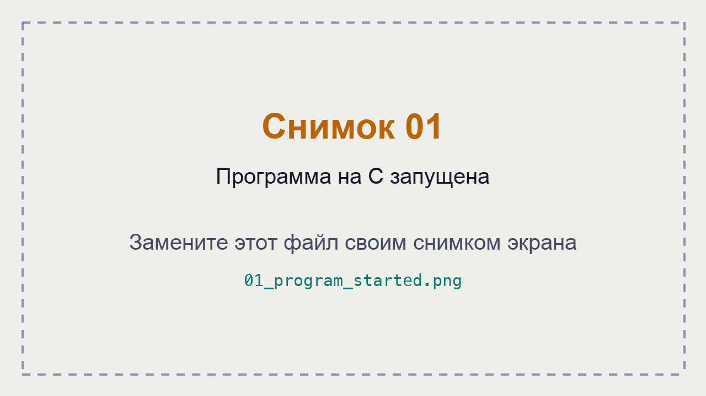
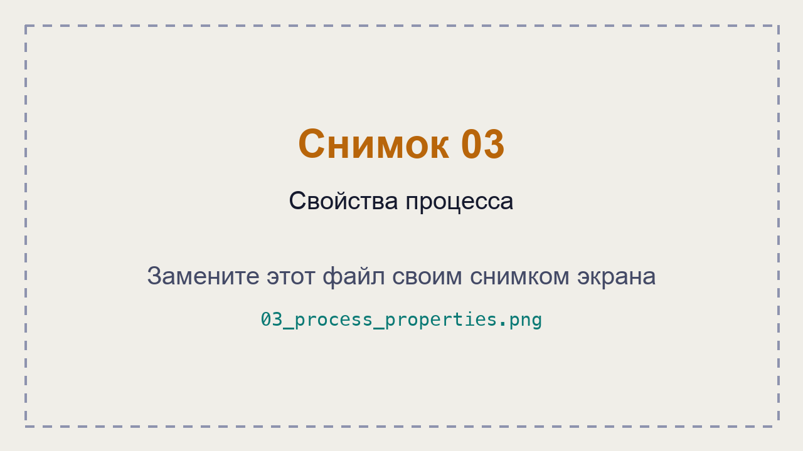
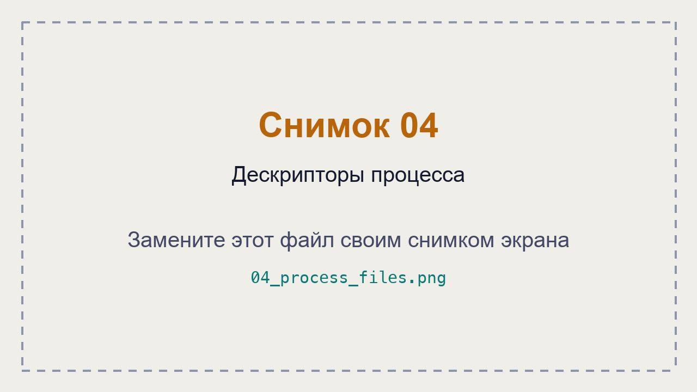
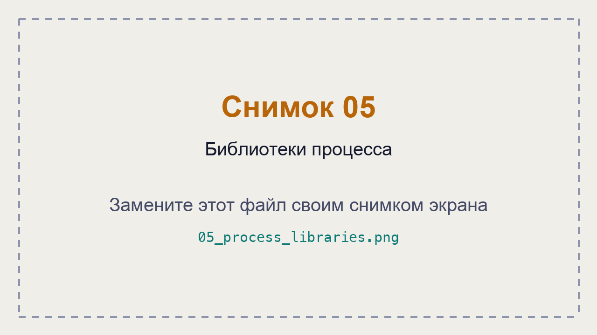
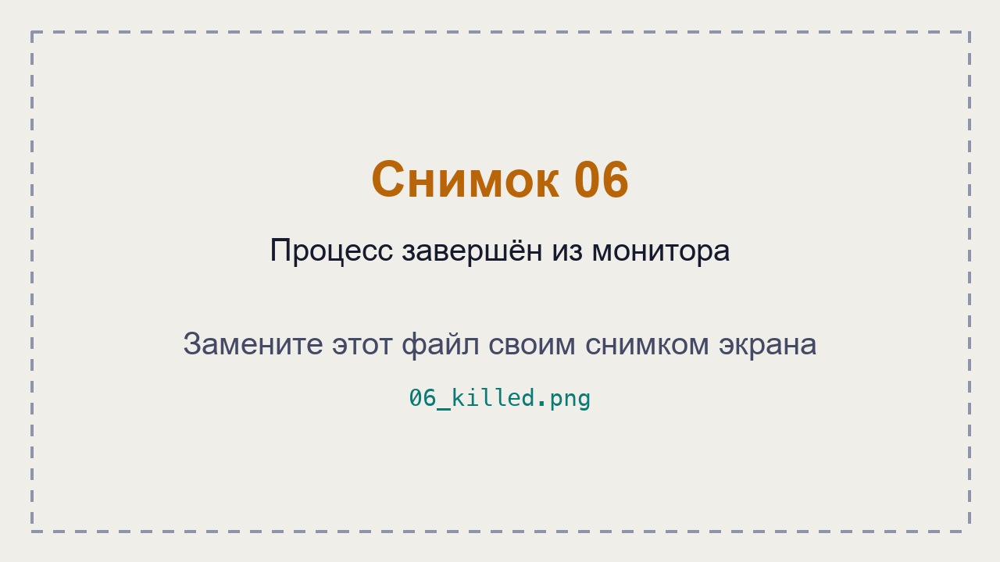
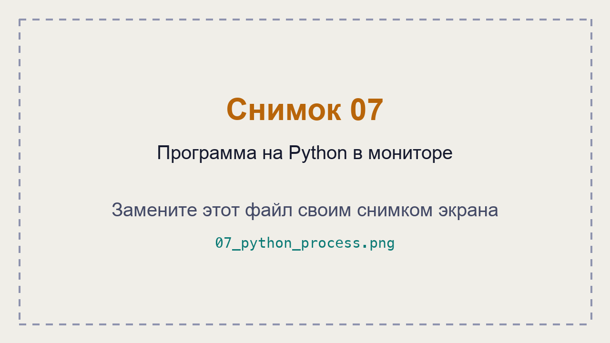
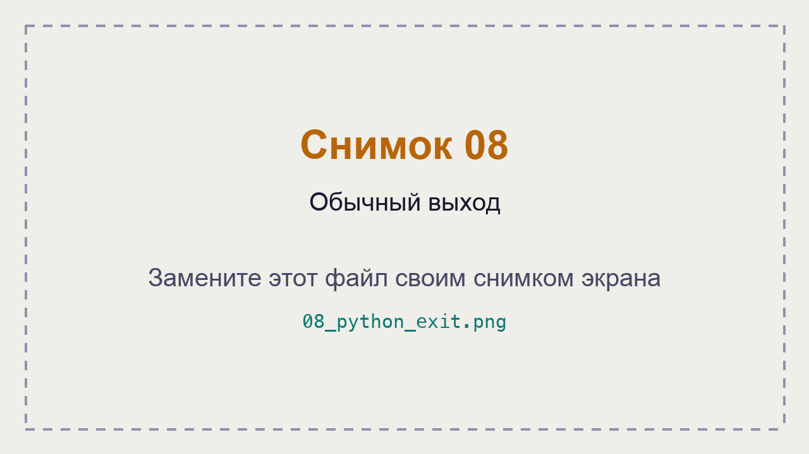

# ЛР 1. Процесс изнутри

Система: ___ · компилятор: ___ (первая строка вывода версии)

## Программа на C
Программа напечатала PID ___, монитор показал PID ___.
Память процесса в мониторе: ___. Процессорное время: ___.
Пока программа ждёт Enter, процессорное время не растёт, потому что ___.
Дескрипторов у процесса: ___. Ввод и вывод ведут в ___.
Системные библиотеки в процессе: ___.
После завершения из монитора терминал напечатал ___, код завершения ___.

## Программа на Python
Имя процесса в мониторе: ___, PID ___, память ___.
Памяти больше, чем у программы на C, примерно в ___ раз.
Общая библиотека у программ на C и Python: ___.
Код завершения при обычном выходе: ___.

Не получилось: ___

## Снимки экрана

Сохраните снимок поверх заглушки в папке `screenshots/` с тем же именем — ссылки ниже менять не нужно.

### 1. Программа на C запущена
Шаг 1. Видно: команда сборки и строка `agent v0, pid=…` в терминале.

### 2. Свой процесс в мониторе
Шаг 3. Видно: строка процесса `hello` с тем же номером, что напечатала программа.

### 3. Свойства процесса
Шаг 4. Видно: окно процесса `hello`: номер, память, процессорное время.

### 4. Дескрипторы процесса
Шаг 5. Видно: открытые файлы или дескрипторы: папка программы и устройство терминала.

### 5. Библиотеки процесса
Шаг 6. Видно: загруженные библиотеки (в Linux — карта памяти).

### 6. Процесс завершён из монитора
Шаг 8. Видно: терминал после завершения: сообщение оболочки и код завершения.

### 7. Программа на Python в мониторе
Шаг 9. Видно: строка `agent v0 (python), pid=…` и процесс Python с тем же номером.

### 8. Обычный выход
Шаг 11. Видно: терминал после Enter: код завершения 0.

