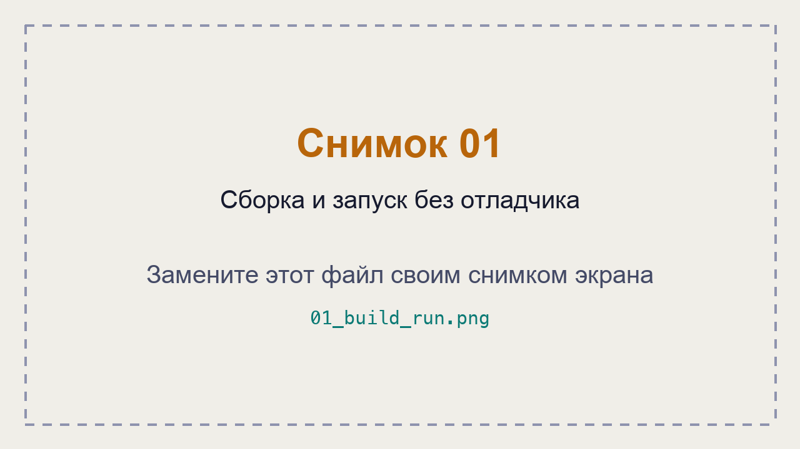
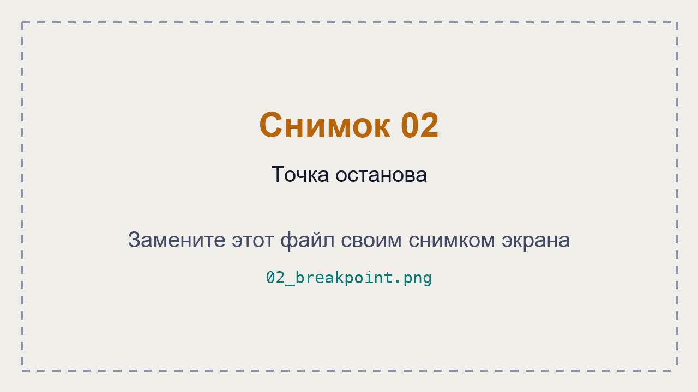
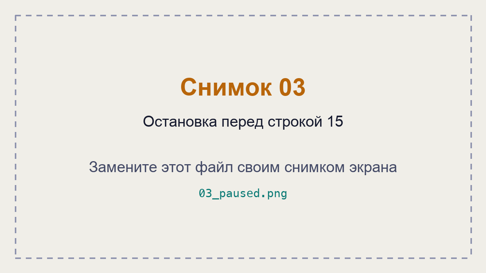
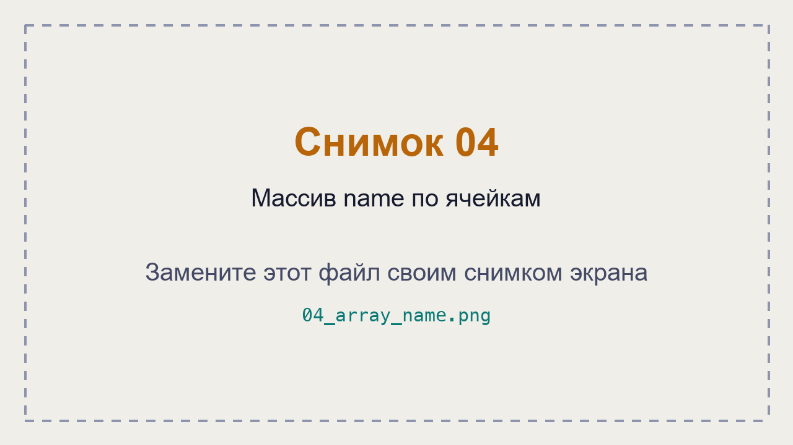
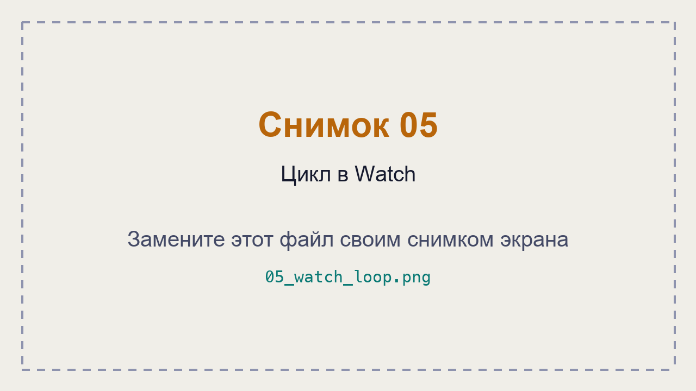
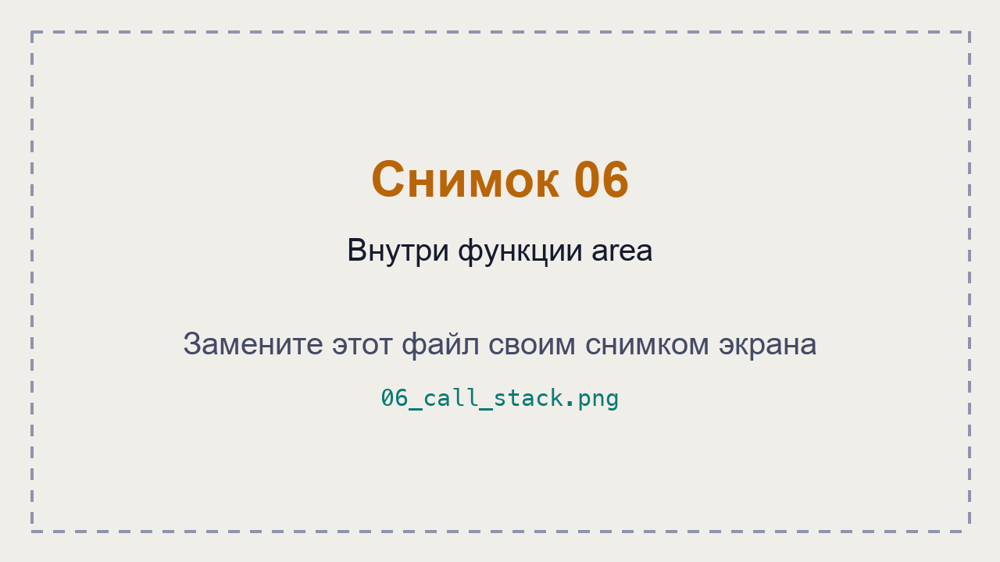
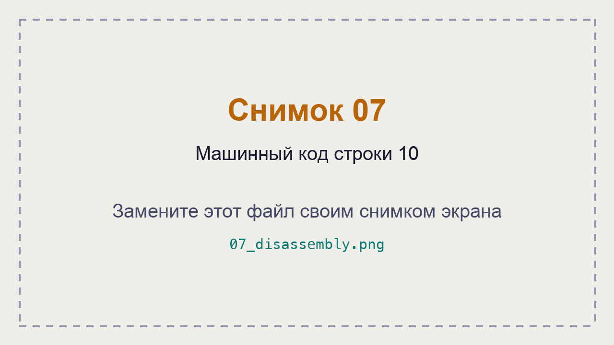
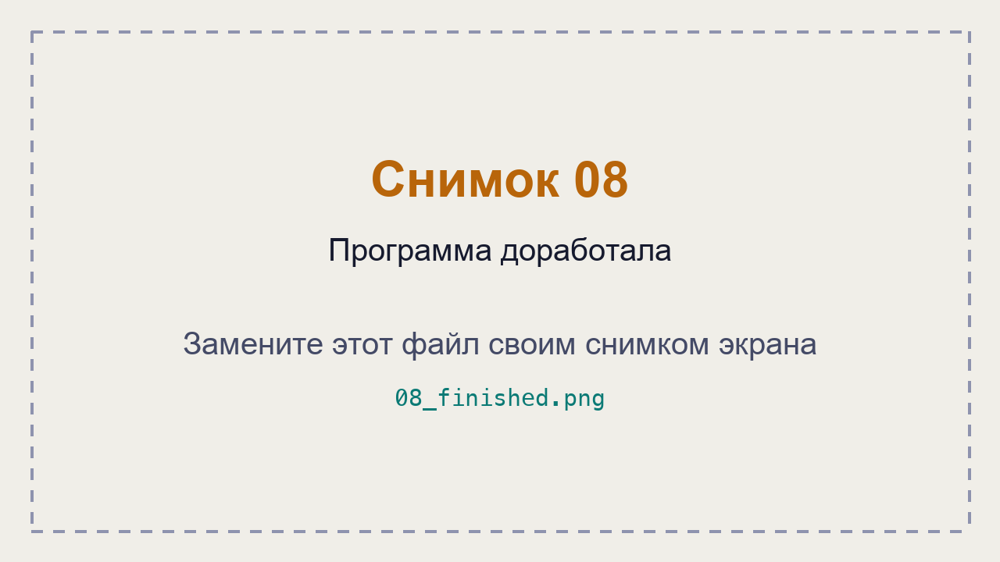

# ЛР 2. Программа в отладчике

Система: ___ · отладчик: ___ (LLDB, GDB или Visual Studio)

## Остановка и переменные
Программа без отладчика напечатала: ___
Точка останова на строке ___.
До строки 15: p.x = ___, p.y = ___, total = ___.
После строки 15: p.x = ___, p.y = ___.
Строку 16 отладчик пропустил, потому что ___.
name[0] = ___ (код буквы), завершающий ноль в ячейке ___.

## Цикл и функция
На кадре цикла: i = ___, total = ___; после следующего шага total = ___.
В стеке внутри area строк: ___, сверху функция ___.
Команда умножения в машинном коде: ___.
Перед printf: a = ___, total = ___.
Код завершения программы: ___.

Не получилось: ___

## Снимки экрана

Сохраните снимок поверх заглушки в папке `screenshots/` с тем же именем — ссылки ниже менять не нужно.

### 1. Сборка и запуск без отладчика
Шаг 1. Видно: команда сборки и строка `agent: total=6 area=12`.

### 2. Точка останова
Шаг 3. Видно: красная точка у строки 15 и она же в списке Breakpoints.

### 3. Остановка перед строкой 15
Шаг 4. Видно: жёлтая стрелка у строки 15, переменные в Variables до присваивания.

### 4. Массив name по ячейкам
Шаг 6. Видно: раскрытый `name`: буквы `agent` и ноль в `[5]`.

### 5. Цикл в Watch
Шаг 7. Видно: `i` и `total` в разделе Watch на втором проходе цикла.

### 6. Внутри функции area
Шаг 8. Видно: стрелка в `area`, копия `p` в Variables, две строки в Call Stack.

### 7. Машинный код строки 10
Шаг 9. Видно: вкладка Disassembly с командой умножения.

### 8. Программа доработала
Шаг 11. Видно: вывод программы под отладчиком и код завершения.

