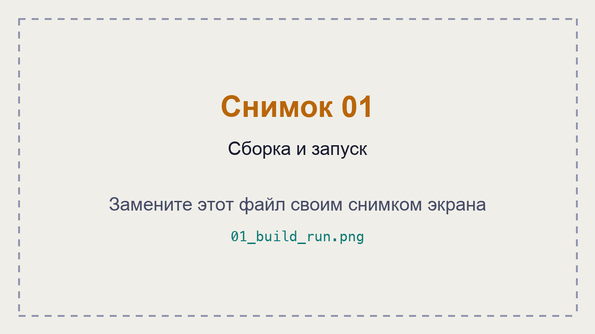
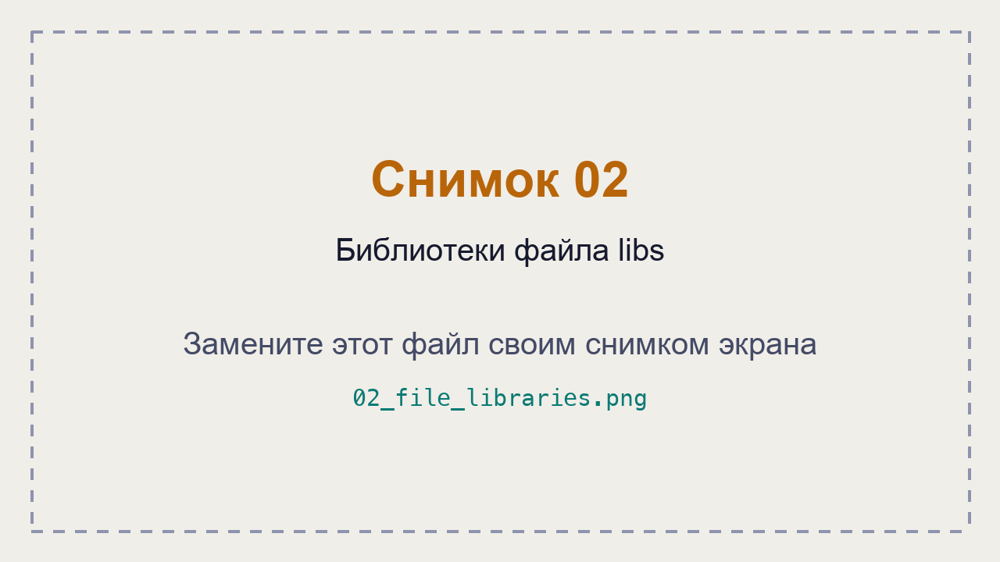
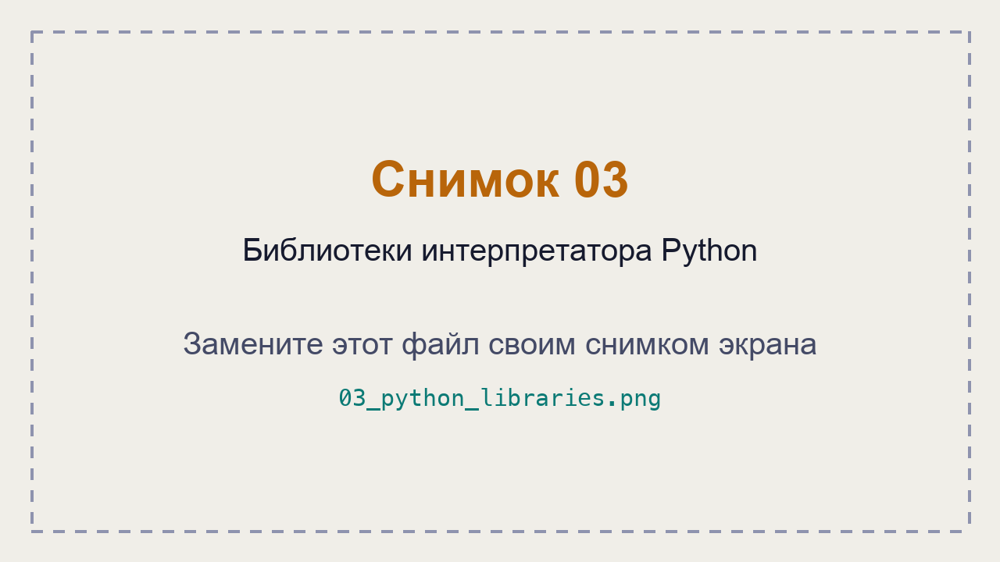
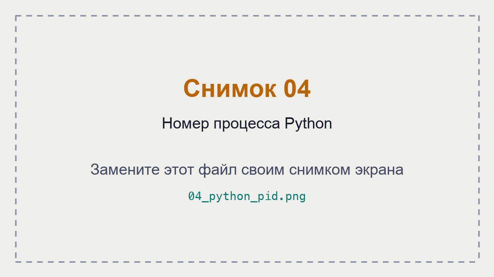
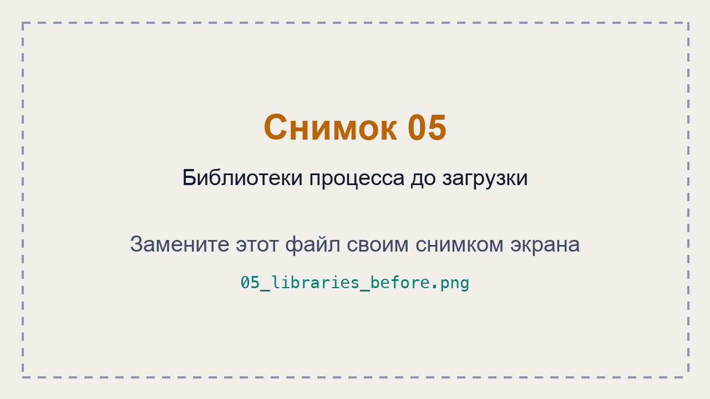
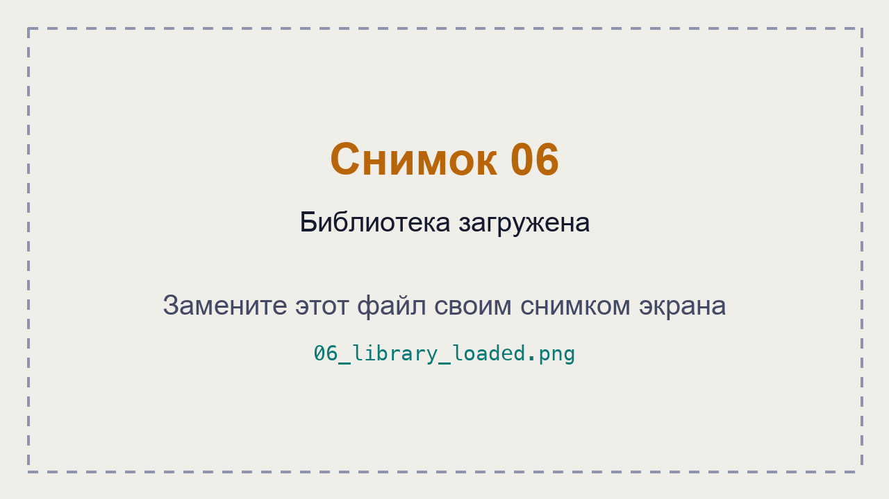
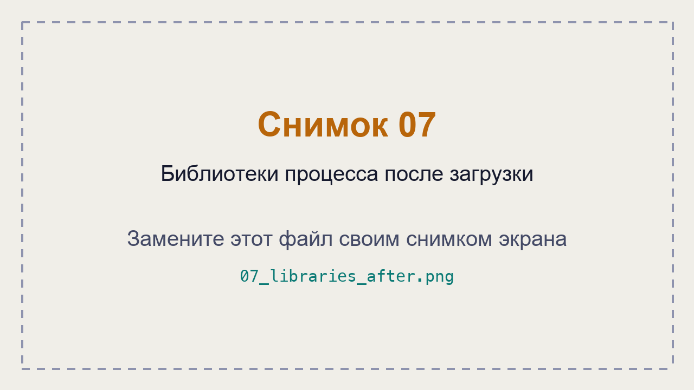

# ЛР 3. Библиотеки программы

Система: ___

## Библиотеки файла
Программа напечатала: ___
Команда для списка библиотек файла: ___
Библиотеки libs: ___
Почему в списке нет отдельной математической библиотеки (или почему она есть): ___
Где лежит интерпретатор Python (файл или библиотека): ___

## Библиотеки процесса
PID Python: ___
Библиотек в процессе до ctypes.CDLL: ___, после: ___
Загруженная библиотека и её полный путь: ___
Функция вернула: ___

Не получилось: ___

## Снимки экрана

Сохраните снимок поверх заглушки в папке `screenshots/` с тем же именем — ссылки ниже менять не нужно.

### 1. Сборка и запуск
Шаг 1. Видно: команда сборки и строка `sqrt(2) = 1.414214`.

### 2. Библиотеки файла libs
Шаг 2. Видно: вывод `dumpbin /dependents` / `otool -L` / `ldd` для своей программы.

### 3. Библиотеки интерпретатора Python
Шаг 3. Видно: тот же вывод для файла Python.

### 4. Номер процесса Python
Шаг 4. Видно: запущенный Python и его номер процесса.

### 5. Библиотеки процесса до загрузки
Шаг 5. Видно: число библиотек процесса Python до `ctypes.CDLL`.

### 6. Библиотека загружена
Шаг 6. Видно: строка `ctypes.CDLL` и результат вызова функции библиотеки.

### 7. Библиотеки процесса после загрузки
Шаг 7. Видно: новое число библиотек и строка загруженной библиотеки.

