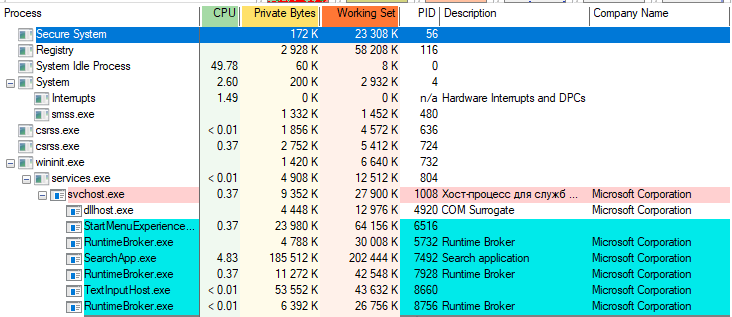
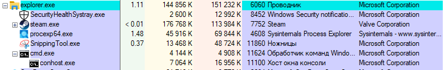
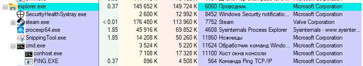
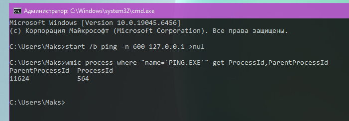
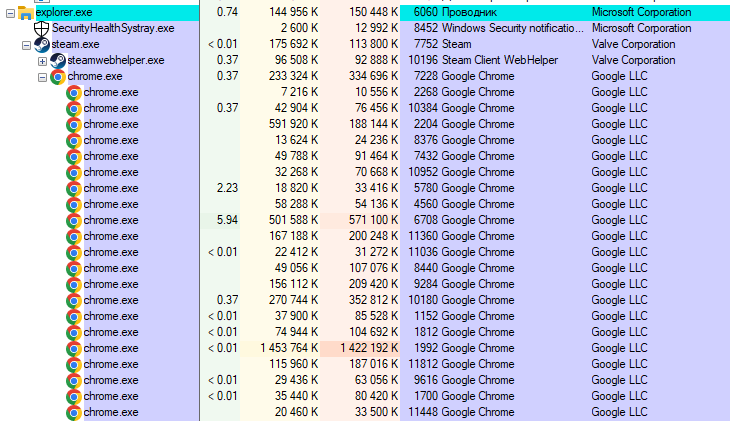
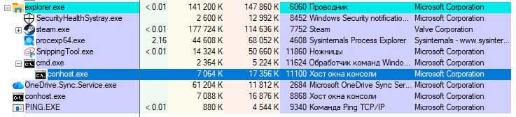

# ЛР 4. Дерево процессов

Система: Windows 10 (HOME-PC)

## Дерево
Процесс в начале дерева и его номер: Secure System (PID 56), Registry (PID 116), System Idle Process (PID 0), System (PID 4)
Цепочка родителей терминала (имя и номер): explorer.exe (6060) → cmd.exe (11624) → conhost.exe (11100)
Дочерний процесс: номер 564, родитель 11624
Команда, которой проверен родитель: wmic process where "name='PING.EXE'" get ProcessId,ParentProcessId
Процессов у браузера и имя процесса вкладок: много процессов chrome.exe, главный chrome.exe (PID 7228)

## Сирота
Номер сироты: 9340
Номер родителя до и после завершения настоящего родителя: до — cmd.exe (PID 2364), после — conhost.exe (PID 8868) под OneDrive.Sync.Service.exe (PID 2684)
Где сирота стоит в дереве: под OneDrive.Sync.Service.exe → conhost.exe → PING.EXE

Не получилось: походу не работал режим дерева, и я вообще ничего с этим не смог поделать, к сожалению

## Снимки экрана

Сохраните снимок поверх заглушки в папке `screenshots/` с тем же именем — ссылки ниже менять не нужно.

### 1. Начало дерева процессов
Шаг 1. Видно: дерево процессов в мониторе: первые процессы системы и их номера.

### 2. Терминал и его родители
Шаг 2. Видно: ветка дерева от процесса терминала вверх до процесса системы.

### 3. Дочерний процесс терминала
Шаг 3. Видно: запущенный из терминала процесс под оболочкой терминала.

### 4. Родитель по команде
Шаг 4. Видно: вывод команды с номером процесса и номером его родителя.

### 5. Процессы браузера
Шаг 5. Видно: раскрытая ветка браузера с дочерними процессами.

### 6. Процесс без родителя
Шаг 6. Видно: команда запуска и номер родителя у оставшегося процесса.

### 7. Сирота в дереве
Шаг 7. Видно: тот же процесс в дереве монитора на новом месте.

