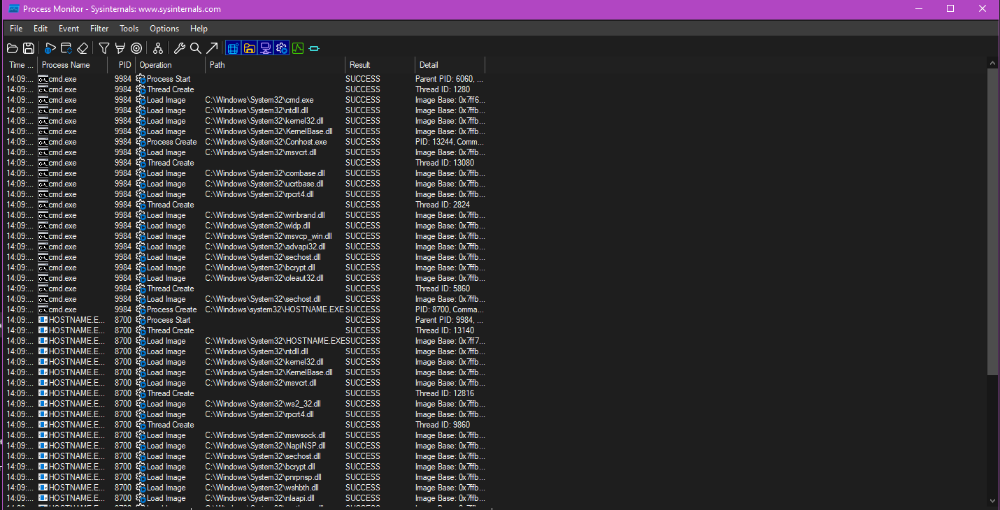
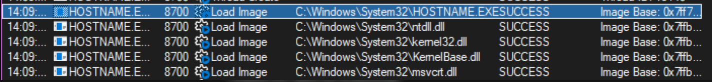
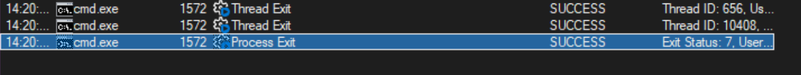
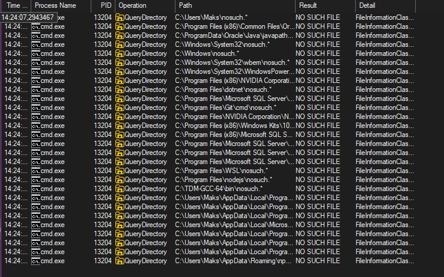
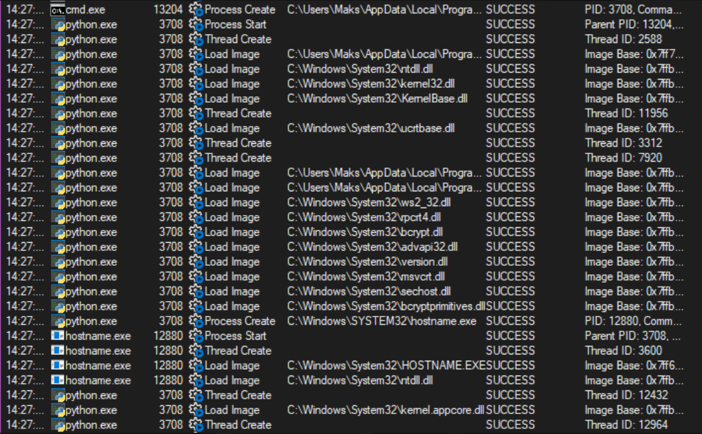

# ЛР 5. Рождение процесса

Система: Windows 10 (HOME-PC). Программа записи: Process Monitor (Procmon64.exe).

## Рождение

Родитель (имя и номер): cmd.exe, PID 9984. Номер нового процесса: HOSTNAME.EXE, PID 8700. Событие или вызов, которым создан процесс: Process Create. Библиотек загружено и первая из них: 18, первая — ntdll.dll.

## Завершение

Код завершения у ребёнка и у родителя: 7 (Exit Status: 7 у ребёнка, %errorlevel% = 7 у родителя). Программа nosuch: папок проверено 20, ошибка 2 (ERROR_FILE_NOT_FOUND), код 1.

## Запуск из Python

Номер Python и номер ребёнка: python.exe PID 3708, hostname.exe PID 12880. Чем запуск из Python отличается от запуска из оболочки: Python напрямую вызывает Process Create для hostname.exe, без промежуточной оболочки cmd.exe — родитель сразу python, а не cmd.

Не получилось: ___

## Снимки экрана

Сохраните снимок поверх заглушки в папке `screenshots/` с тем же именем — ссылки ниже менять не нужно.

### 1. Рождение процесса
Шаг 1. Видно: запись запуска `hostname`: родитель создаёт процесс, у нового процесса номер родителя.

### 2. Библиотеки нового процесса
Шаг 2. Видно: библиотеки, которые загрузил `hostname`, и первая из них.

### 3. Код завершения 7
Шаг 3. Видно: завершение ребёнка с кодом 7 и тот же код у родителя.

### 4. Программы нет
Шаг 4. Видно: поиск `nosuch` по папкам из PATH и ошибка «не найдено».

### 5. Запуск из Python
Шаг 5. Видно: Python создаёт процесс `hostname`: номер Python и номер ребёнка.

