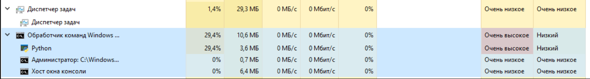
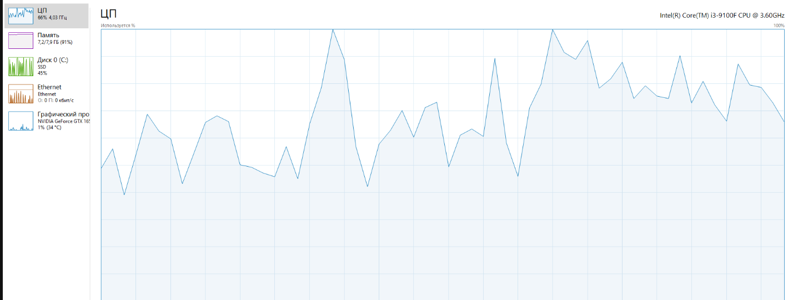
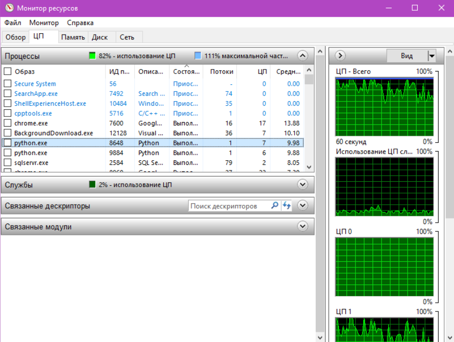
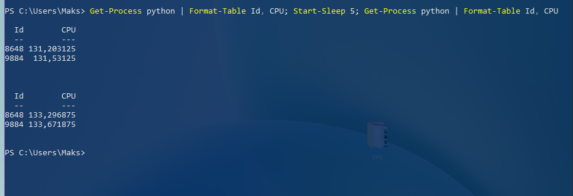

# ЛР 6. Кто загружает процессор

Система: Windows 10 (HOME-PC). Ядер (логических процессоров): 4 (Intel i3-9100F).

## Одна нагрузка

Процент процесса в мониторе: 29.4%. Общая загрузка: 37%. На каких ядрах видна нагрузка: программа прыгает между всеми ядрами (видно в Мониторе ресурсов — пики на разных графиках ЦП 0, ЦП 1 и т.д.), ни на одном нет сплошной полосы 100%.

## Две нагрузки

Проценты обеих нагрузок и общая загрузка: python.exe PID 12300 — 23.13%, python.exe PID 5372 — 22.27%, общая загрузка 66% в Диспетчере задач (89% в Мониторе ресурсов — другая шкала). На одном ядре (в macOS — фоновый режим): при запуске с /affinity 1 обе программы сидят на ядре 0, каждая ~10-11%, ядро 0 загружено полностью (сплошная полоса 100%), остальные ядра свободны.

## Процессорное время

Первый замер, второй замер, пауза: PID 8648 — 131.20 сек → 133.30 сек, PID 9884 — 131.53 сек → 133.67 сек, пауза 5 секунд. Загрузка по замерам: 8648 — 2.10/5 = 42% ядра, 9884 — 2.14/5 = 43% ядра. Почему процент в мониторе не говорит о скорости работы: процент — это доля времени ядра, а не количество выполненных операций. Две программы на разных ядрах работают с одинаковой скоростью (пустой цикл), но если ядер мало — процент выше, если много — ниже. Скорость цикла от процента не зависит.

Не получилось: ___

## Снимки экрана

Сохраните снимок поверх заглушки в папке `screenshots/` с тем же именем — ссылки ниже менять не нужно.

### 1. Одна нагрузка
Шаг 1. Видно: процесс Python в мониторе: его процент и общая загрузка.

### 2. Две нагрузки
Шаг 3. Видно: два процесса Python и загрузка ядер.

### 3. Нагрузки на одном ядре
Шаг 4. Видно: две нагрузки на одном ядре и их проценты; в macOS — два числа оборотов цикла.

### 4. Процессорное время
Шаг 5. Видно: два замера процессорного времени с паузой между ними.

