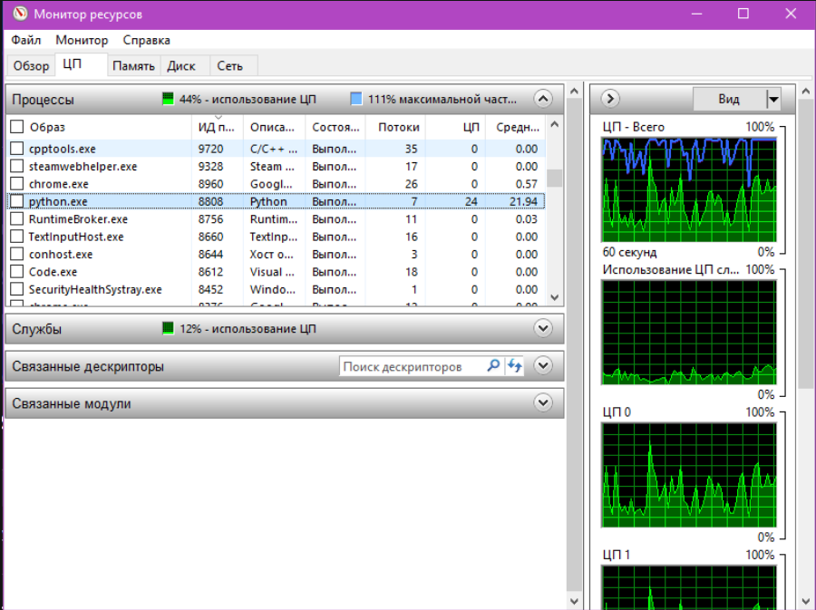
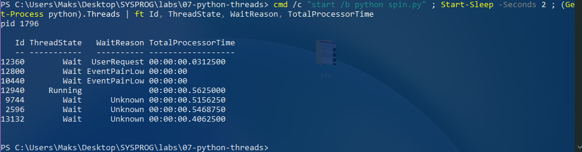
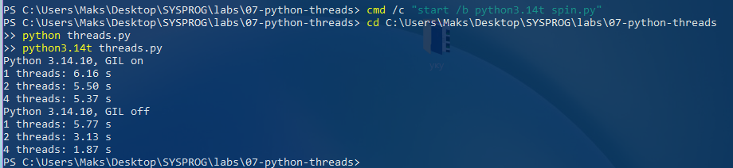

# ЛР 7. Потоки Python и GIL

Система: Windows 10 (HOME-PC).
Ядер (логических процессоров): 4 (Intel i3-9100F).
Версии Python (обычный и без GIL): 3.14.10 и 3.14.10+freethreaded.

## Python с GIL

Процент процесса и число потоков: 25% ЦП, 7 потоков (4 рабочих + 3 служебных).
Сколько потоков выполняется одновременно: 1 (один Running, остальные Wait — ждут GIL).

## Python без GIL

Процент процесса и проценты потоков: 74% ЦП, 3 потока. Все ядра загружены, рабочие трудятся одновременно.

## Время работы

С GIL, 1 / 2 / 4 потока: 6.16 / 5.50 / 5.37 с — время почти одинаковое, рабочие ждут очереди.
Без GIL, 1 / 2 / 4 потока: 5.77 / 3.13 / 1.87 с — ускорение в ~3 раза с 4 рабочими.
Без GIL с PYTHON_GIL=1: 5.93 / 5.93 / 5.73 с — время снова одинаковое, замок включён.
Ожидание, 1 и 4 потока: 2.00 / 2.00 с — ждущие рабочие отдают GIL, поэтому 4 потока спят одновременно за 2 секунды.

Почему ожидающие потоки ускоряются и с GIL: потому что они не выполняют код Python, а ждут (sleep/сеть/диск). В этот момент GIL освобождается и другой рабочий может работать.

Не получилось: ___

## Снимки экрана

Сохраните снимок поверх заглушки в папке `screenshots/` с тем же именем — ссылки ниже менять не нужно.

### 1. Четыре потока с GIL
Шаг 1. Видно: процесс Python в мониторе: его процент и число потоков.

### 2. Потоки процесса
Шаг 2. Видно: список потоков процесса: сколько выполняется, сколько ждёт.

### 3. Четыре потока без GIL
Шаг 3. Видно: процесс python3.14t в мониторе: его процент.

### 4. Время работы
Шаг 4. Видно: вывод threads.py в Python с GIL и без.

