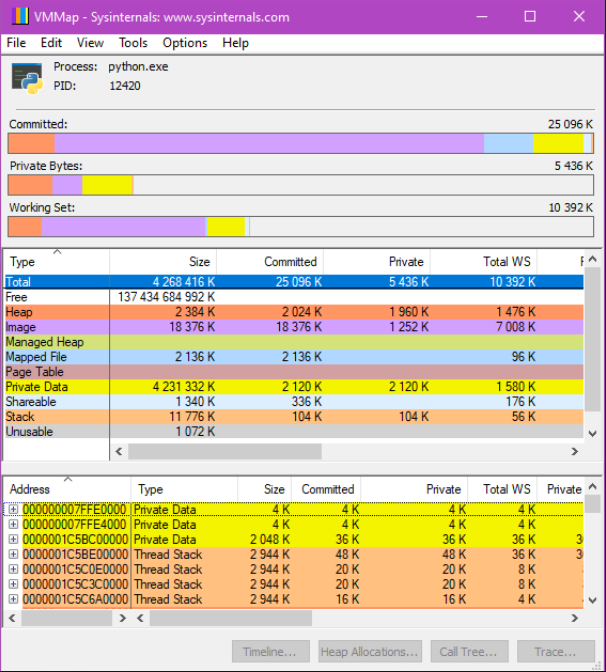
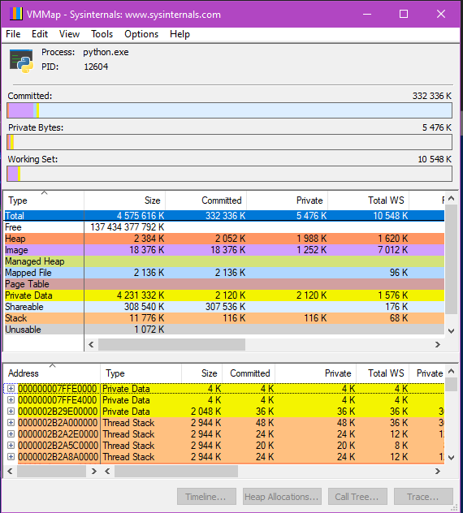
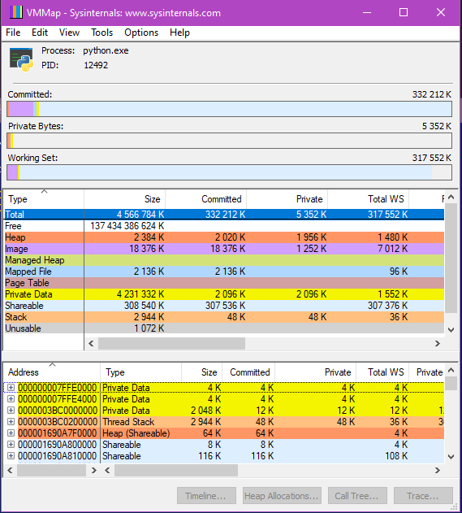
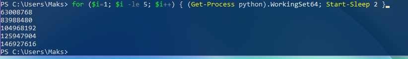

# ЛР 8. Карта памяти

Система: Windows 10 (HOME-PC), Intel i3-9100F, 4 ядра.
Чем мерил (виртуальная и занятая): PowerShell (VirtualMemorySize64, WorkingSet64) и VMMAP.

## Этапы mem.py
Старт: ~4167 МБ / ~10 МБ
Получил 300 МБ: ~4467 МБ / ~10 МБ
Записал в каждую страницу: ~4467 МБ / ~3096 МБ
Освободил: ~4167 МБ / ~10 МБ
Почему занятая память выросла только на третьем этапе: mmap только резервирует адресное пространство (растёт "обещано"). Реальная физическая память ("занято") выделяется операционной системой только при первой фактической записи в страницу (page fault).

## Карта памяти
Из каких частей состоит память процесса: Image (исполняемый файл и библиотеки), Heap (куча), Mapped File (отображённые файлы), Private Data (частные данные, включая выделенный через mmap блок), Stack (стек потоков).

## Утечка
Пять замеров leak.py: 63 008 768 → 83 988 480 → 104 968 192 → 125 947 904 → 146 927 616 байт (~63 МБ → ~147 МБ).
На сколько росла память за 2 секунды: ~21 МБ (ровно на размер добавляемых в список данных).

Не получилось: ___

## Снимки экрана

Сохраните снимок поверх заглушки в папке `screenshots/` с тем же именем — ссылки ниже менять не нужно.

### 1. Карта памяти
Шаг 2. Видно: карта памяти процесса mem.py на старте и её итог.

### 2. Получено 300 МБ
Шаг 3. Видно: виртуальная память выросла на 300 МБ, занятая — нет.

### 3. Страницы заняты
Шаг 4. Видно: занятая память (в macOS — физический след) после записи в каждую страницу.

### 4. Утечка
Шаг 6. Видно: пять замеров памяти leak.py.

