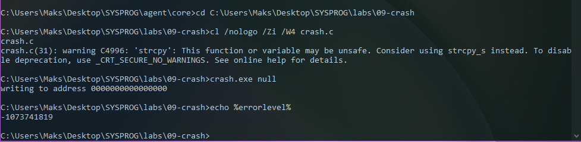
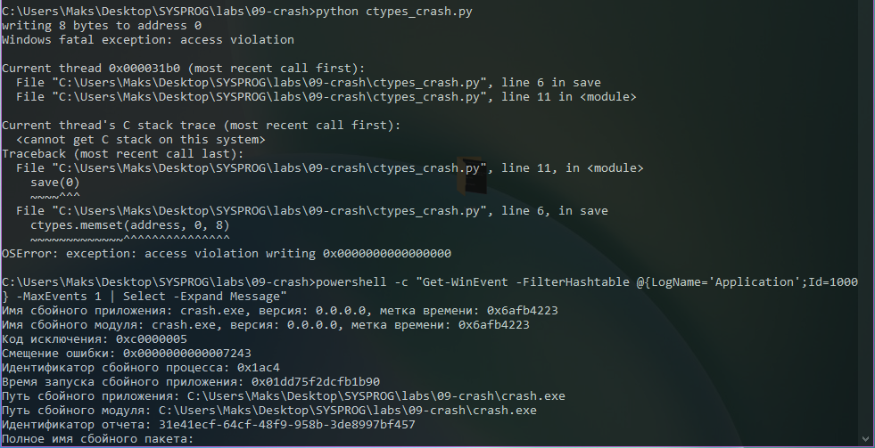
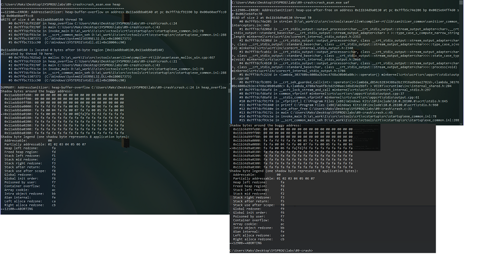
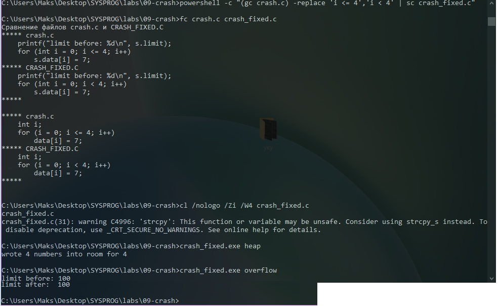

# ЛР 9. Разбор падения

Система: Windows 10 (HOME-PC), Intel i3-9100F.
Компилятор: MSVC (cl) с AddressSanitizer (/fsanitize=address).

## Падение
crash null: напечатано "writing to address 0000000000000000", код завершения -1073741819 (0xC0000005 — нарушение доступа).
ctypes_crash.py: Python вывел "Windows fatal exception: access violation" и OSError: exception: access violation writing 0x0000000000000000 (строки 6 и 11). Python выжил, ctypes превратил ошибку в исключение.
Где система записала падение: журнал Windows "Приложение", событие 1000, код исключения 0xc0000005, путь crash.exe.

## Молчаливые ошибки
crash overflow: limit до: 100, после: 7, код завершения: 0 (программа не упала, данные испорчены).
crash heap без проверки: "wrote 5 numbers into room for 4", код 0 (ошибка прошла молча).
AddressSanitizer для heap: ошибка "heap-buffer-overflow", строка 24 в crash.c (WRITE of size 4).
AddressSanitizer для uaf: ошибка "heap-use-after-free", строка 33 (чтение) и строка 32 (free) в crash.c.

## Исправление
Что изменено: в crash.c заменено "i <= 4" на "i < 4" в двух циклах (функции overflow и heap_overflow). Создан crash_fixed.c.
Что напечатала исправленная программа:
- crash_fixed.exe heap: "wrote 4 numbers into room for 4" (правильно, 4 числа в массив на 4)
- crash_fixed.exe overflow: "limit before: 100", "limit after: 100" (limit не испортился)

Не получилось: ___

## Снимки экрана

Сохраните снимок поверх заглушки в папке `screenshots/` с тем же именем — ссылки ниже менять не нужно.

### 1. Падение
Шаг 1. Видно: запуск crash null и код завершения.

### 2. Падение Python
Шаг 2. Видно: вывод ctypes_crash.py и запись системы о падении.

### 3. Отчёт AddressSanitizer
Шаг 4. Видно: вывод crash heap без проверки и с AddressSanitizer (на Windows с ARM — без проверки).

### 4. Исправление
Шаг 6. Видно: разница файлов и вывод исправленной программы.

