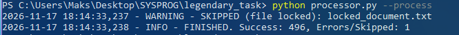

# Legendary Task

Система: Windows 10 (HOME-PC).
Язык: Python 3.14, только стандартная библиотека.
Скрипт: `processor.py`, команды `--generate` и `--process`.

## Что требовалось по тз 

Программа берёт документы из одной папки, переименовывает по правилам
и раскладывает в другую. На трёх файлах это работает, но в реальной
жизни прилетают: два файла с одинаковым именем, файл на несколько
гигабайт, файл, который в этот момент открыт в другой программе,
несколько сотен файлов сразу, и обязательно проверка повторного запуска.

## Что я сделал

Один скрипт `processor.py`. Две команды:

- `--generate` — создаёт тестовые файлы: 497 штук, включая дубликаты
  имени `order.txt`, один файл на 50 МБ и `locked_document.txt` для
  проверки блокировки;
- `--process` — переносит файлы из `input_orders` в `output_processed`.

## Как закрыты проблемы

**Одинаковые имена.** Каждому файлу при переносе добавляется timestamp
в миллисекундах. Даже если в папке лежат сто файлов `order.txt`, после
обработки они станут `processed_<ts>_order.txt` с разными `ts`.
Столкновений не будет.

**Большие файлы.** Используется `shutil.move`. Если источник и приёмник
на одном диске, ОС просто меняет имя записи в файловой таблице — файл
не читается в память целиком. Поэтому хоть 50 МБ, хоть 5 ГБ — перенос
происходит мгновенно и не грузит RAM.

**Файл занят другим процессом.** Обёрнуто в `try / except PermissionError`.
Если Windows не даёт тронуть файл, программа пишет предупреждение в лог
и идёт к следующему. Не падает.

**Несколько сотен файлов.** Тестовый запуск генерирует 497 файлов,
включая 55 дубликатов имени `order.txt`. Обработка занимает секунды.

**Повторный запуск.** Файлы, которые не удалось перенести (заблокированы),
остаются в `input_orders`. Запускаешь программу ещё раз — она берёт их
и переносит. Ничего не теряется, ничего не переносится дважды.

## Проверка на практике

Сначала генерация: `python processor.py --generate`.

Потом блокировка файла во втором окне PowerShell через
`[System.IO.File]::Open(..., 'None')` — это настоящая блокировка,
в отличие от Блокнота, который в Windows не держит дескриптор.
Запуск обработки даёт `SKIPPED (file locked)` и `Success: 496,
Errors/Skipped: 1`. Программа не упала.

После снятия блокировки повторный запуск даёт `Success: 1,
Errors/Skipped: 0` — добирает то, что не смог в прошлый раз.

Не получилось: не сразу получлось разобраться с кодом, поэтому не самое сложное задание доставило неудобств.

## Снимки экрана

Снимки лежат в `screenshots/`, имена соответствуют шагам.

### 1. Генерация тестовых файлов

Шаг 1. Видно: `python processor.py --generate` и подсчёт файлов
командой `(Get-ChildItem input_orders).Count` — 497 файлов.

### 2. Обработка с заблокированным файлом

Шаг 2. Видно: `python processor.py --process` при реально
заблокированном `locked_document.txt`. В логе предупреждение
`SKIPPED (file locked): locked_document.txt`, итог
`Success: 496, Errors/Skipped: 1`. Программа не упала.

### 3. Повторный запуск

Шаг 3. Видно: тот же `python processor.py --process` после снятия
блокировки. В логе `Success: 1, Errors/Skipped: 0` — оставшийся
файл перенёсся. Повторный запуск безопасен.

